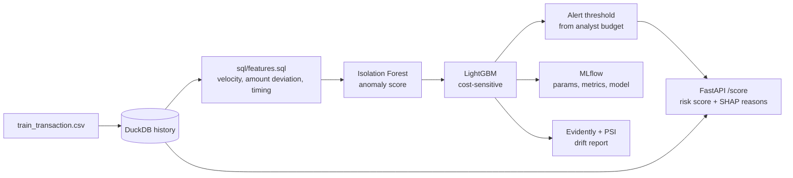

# FraudGuard: transaction fraud detection and risk scoring

An end-to-end fraud detection service on the [IEEE-CIS Fraud Detection](https://www.kaggle.com/c/ieee-fraud-detection)
payment data: SQL behavioural features, an imbalanced-data model with an anomaly score,
a REST API that returns a risk score with reasons, and drift monitoring over later months.



## Results

Test set = the last 20% of the timeline, never seen during training or threshold tuning.
Alert threshold set so that 2% of transactions are sent to analysts.

| Model | PR-AUC | ROC-AUC | Precision @ alert | Recall @ alert | Recall @ precision ≥ 0.5 |
| --- | --- | --- | --- | --- | --- |
| Logistic Regression (baseline) | 0.215 | 0.833 | 0.341 | 0.326 | 0.024 |
| LightGBM + SQL features + anomaly score | **0.544** | **0.906** | **0.768** | **0.385** | **0.534** |

Numbers come from `reports/metrics.json` after `make train`.

### Feature iterations (LightGBM, same test period)

| Version | Features added | PR-AUC | Precision @ 2% alerts | Recall @ 2% alerts |
| --- | --- | --- | --- | --- |
| v1 | SQL velocity and amount features, C/D/M subset, anomaly score | 0.342 | 0.521 | 0.336 |
| v2 | + 120 deduplicated V columns, frequency encoding, account start-day from D4/D10/D15, more client aggregates | 0.340 | 0.487 | 0.334 |
| v3 | Early-stopping fix (track PR-AUC only), start-day features and client-id frequency removed | **0.544** | **0.768** | **0.385** |

v1 and v2 stopped after a few trees (best iteration 3 in v2): early stopping also watched log-loss,
which gets worse almost at once when the fraud class is weighted. The drift report flagged the
start-day features (PSI above 0.8): they encode absolute dates, so test-period values never occur
in training, and they were removed.

About 3.5% of transactions are fraud, so a random ranking would score a PR-AUC of about 0.035.
v3 still improved slightly at the 3,000-tree cap; `N_ESTIMATORS=6000` may add a little more.

## Quick start

```bash
pip install -r requirements.txt

# 1. Check the setup end to end on fake data (about 1 minute)
make smoke

# 2. Real data: download train_transaction.csv from
#    https://www.kaggle.com/c/ieee-fraud-detection/data into data/raw/
make train      # features, models, threshold, SHAP review, MLflow logging
make drift      # PSI per feature, weekly PR-AUC, Evidently HTML report
make serve      # API on http://localhost:8000/docs
make mlflow     # experiment UI on http://localhost:5000
```

With Docker:

```bash
docker compose run --rm train      # train + drift inside the container
docker compose up api mlflow
```

Score a transaction:

```bash
curl -X POST localhost:8000/score -H 'Content-Type: application/json' -d '{
  "TransactionID": 4000001, "TransactionDT": 15811200, "TransactionAmt": 249.0,
  "ProductCD": "W", "card1": 13926, "card4": "visa", "card6": "debit",
  "addr1": 315, "P_emaildomain": "gmail.com", "C1": 3, "C13": 5, "D1": 14, "D15": 14
}'
```

Response from the v3 model:

```json
{
  "transaction_id": 4000001,
  "fraud_probability": 0.004224,
  "risk_score": 4,
  "is_alert": false,
  "threshold": 0.306739,
  "reasons": [
    {"feature": "C14", "value": null, "contribution": 0.7572},
    {"feature": "TransactionAmt", "value": 249.0, "contribution": 0.3734},
    {"feature": "V294", "value": null, "contribution": 0.3196}
  ]
}
```

`reasons` are the three features that pushed the score up most (SHAP, log-odds). Fields left out of
the request are treated as missing, which is why `C14` and `V294` show `null` here.

## Design decisions

- **Time-based split, not random.** Fraud patterns change over time; a random split leaks
  future behaviour into training and overstates performance. Train on the first 65% of the
  timeline, tune on the next 15%, test on the last 20%.
- **One SQL file for training and serving.** `sql/features.sql` runs over the full history at
  training time and over one card's last 30 days plus the new transaction in the API.
  `tests/test_pipeline.py` checks that both paths give the same feature values, which rules out
  training/serving skew. A cumulative "transactions so far" feature was dropped because the API
  cannot compute it from a 30-day window and it drifts by construction.
- **Client id (`uid`).** Card id alone mixes many people. `card1 + addr1 + (day - D1)` approximates
  one account, because D1 counts days since the account's first transaction.
- **Fewer V columns.** Vesta's 339 V features come in groups of near-duplicates; one column per
  group keeps most of the signal at a third of the memory.
- **Frequency encoding.** How common a card, address or email domain is in the training period.
  Fraud often comes from rare values. Learned on the training period only and saved with the model,
  so the API uses the same mapping.
- **Imbalance.** About 3.5% of transactions are fraud. No SMOTE: oversampling synthetic points
  in a space with many missing values adds noise and slows the pipeline. PR-AUC and the alert
  threshold only depend on the ranking, so class weighting is optional (`POS_WEIGHT=auto` to try it).
- **Early stopping on PR-AUC only.** LightGBM also tracks log-loss by default and stops when any
  metric stops improving; with class weighting that happened after 3 trees.
- **Metrics.** Accuracy is meaningless here (96.5% by predicting "legit"). PR-AUC is the main
  metric; precision and recall are reported at the operating threshold.
- **Threshold from an alert budget.** Analysts can only review so many cases. The threshold flags
  `ALERT_RATE` (default 2%) of validation traffic, then is applied unchanged to the test period.
- **Anomaly score as a feature.** An Isolation Forest fitted on legitimate traffic only gives an
  unsupervised "how unusual is this" signal that also helps on fraud types missing from the labels.
- **Reason codes.** SHAP values give the top three features behind each alert, so an analyst sees
  *why* a transaction was flagged. `reports/false_positives.csv` lists the 50 highest-scoring
  legitimate transactions with their reasons, as a starting point for error analysis.
- **Drift monitoring.** PSI per feature and on the score (> 0.2 = significant shift), weekly PR-AUC
  through the production period, and an Evidently data drift report.

## Project layout

```
sql/features.sql          behavioural features (DuckDB)
fraudguard/features.py    load CSV, run the SQL for batch and single transactions
fraudguard/train.py       split, Isolation Forest, baselines, LightGBM, threshold, MLflow
fraudguard/metrics.py     PR-AUC, metrics at threshold, recall at fixed precision
fraudguard/explain.py     SHAP reason codes
fraudguard/scorer.py      loads artifacts, scores one transaction
fraudguard/api.py         FastAPI app
fraudguard/drift.py       PSI, weekly PR-AUC, Evidently report
scripts/make_synthetic.py fake data with the same schema, for smoke tests only
tests/                    train/serve feature parity, API tests
```

## Next steps

- Retrain on a rolling window when score PSI crosses the threshold, and compare with the frozen model.
- Streamlit dashboard for the alert queue.
- Graph features (shared devices, emails, addresses between cards).
- LLM-written alert summaries from the SHAP reasons.
